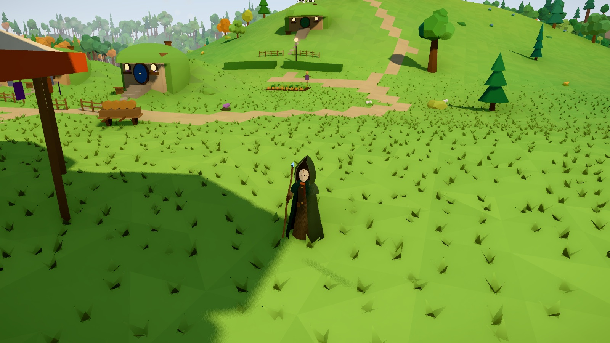
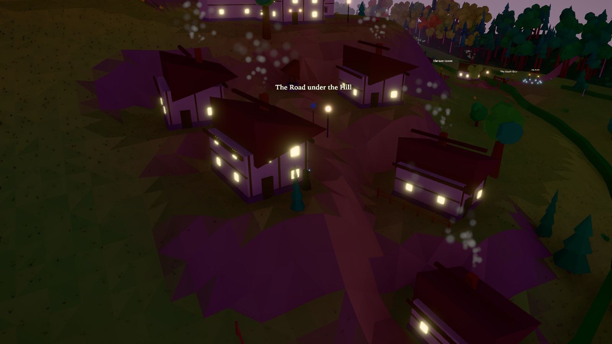
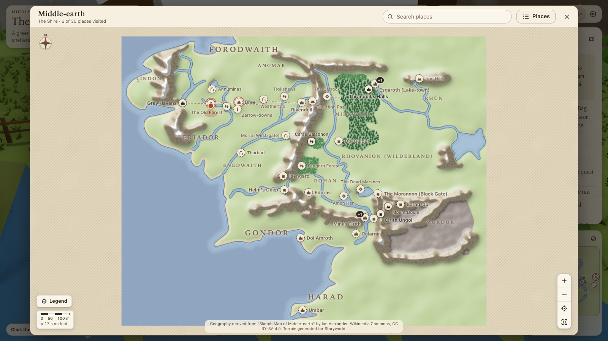
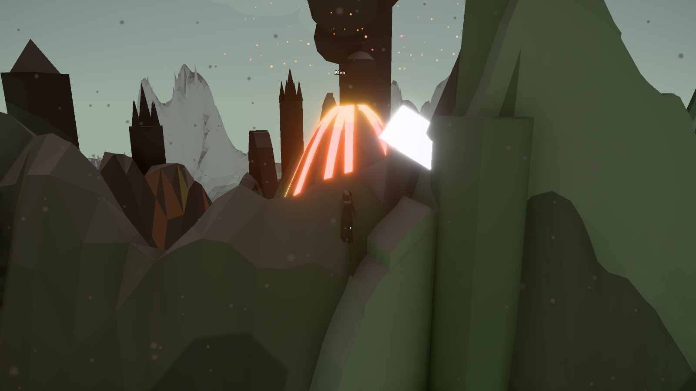
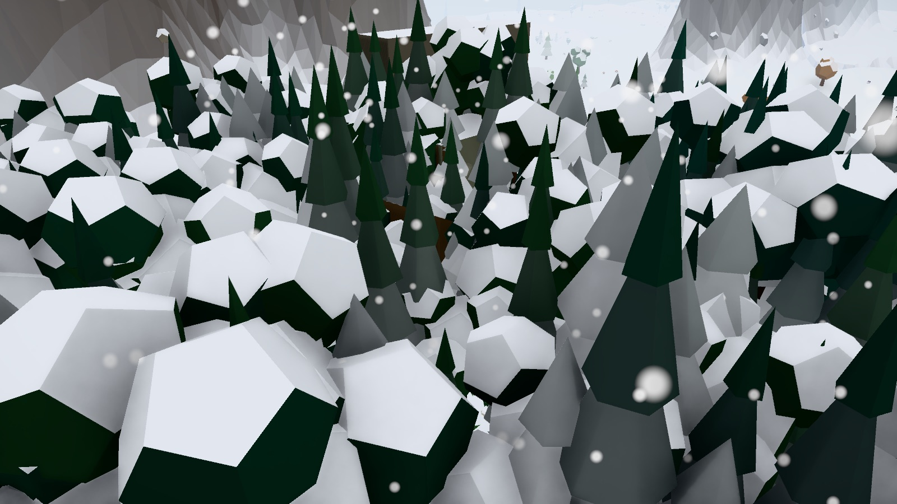
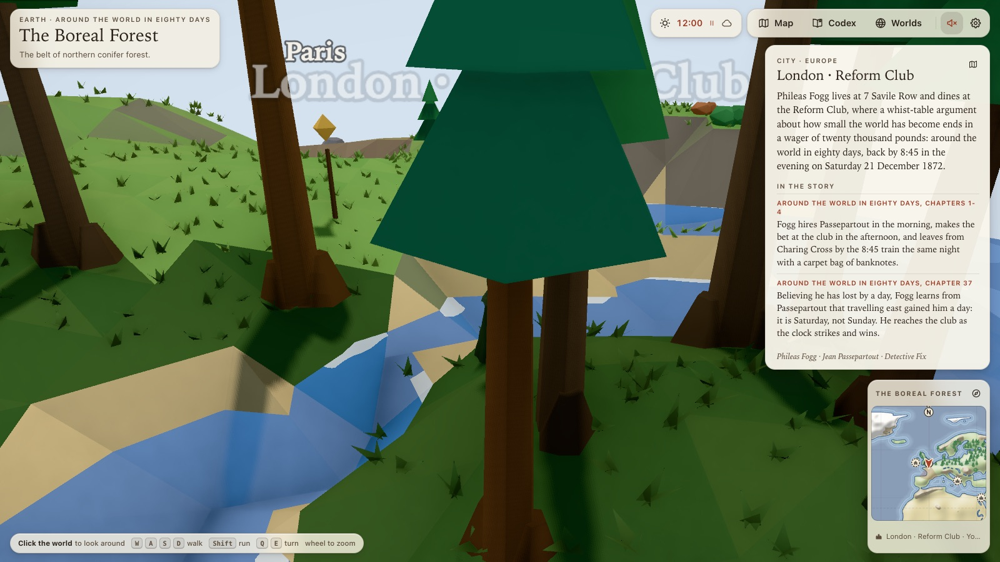

# Storyworld

Roam small, cartoonish 3D versions of the worlds inside stories. The first world is Middle-earth.



| | |
|---|---|
|  |  |
| *Bree at dusk: the day/night clock lights lamps and windows* | *The overview map (**M**): click any place to travel there* |
|  |  |
| *Mordor under ash: weather is rolled per region* | *Snow lying on the woods below Erebor* |
|  | |
| *A second world: Earth as a sphere, following* Around the World in Eighty Days | |

- Walk a miniature Middle-earth (1.25 km across) as a third-person traveller: sea, lakes and rivers, meadows and dry grassland, mixed forests with autumn groves, flowers, rolling hills, snow-capped mountains and the ash plain of Mordor.
- Press **M** for a 2D overview map drawn from the same terrain data. Click any place to travel there.
- Walk up to a waymarker to read what happened there in the story. Press **C** for the codex of discovered places.
- The **Worlds** button switches between Middle-earth and Earth; position and discoveries are kept per world.
- The world runs on a **clock**: the sun rises and sets, the sky and fog go warm at dawn, deep blue at night with stars and a moon, and lamps, windows and the traveller's staff light up after dark. Open the clock in the top-right to drag the time, jump to dawn/noon/dusk/night, freeze it or change the day length.
- Press **Tab** for the editor: sculpt the terrain (raise, lower, smooth, flatten), paint biomes, move or add landmarks, then save straight into `public/worlds/<id>/` in dev (or download `terrain.png` + `world.json`). An edit survives a reload exactly.
- Walk through the gate at Hobbiton and press **Enter** to step into the village at walking scale: Bag End and Bagshot Row on the Hill, the Party Field, the bridge over the Water, Sandyman's mill, Bywater Pool and the Green Dragon, each with its own story notes. The gate at the south edge (or the *Leave* button) takes you back.
- Edoras too: walk to the gate arch at Edoras and press **Enter** to arrive on the road above the ford of the Snowbourn, looking south to the green hill of the kings of Rohan. Wade the ford, follow the road between the white-flecked mounds to the only gate, climb the paved way past dark doors with a stream running beside it in a stone channel, and take the broad stair to the golden hall. The road west (or the *Leave* button) takes you back out.
- And Rivendell: walk to the arch at Rivendell and press **Enter** to arrive on the high moor, where nothing yet shows of the valley. Follow the white stones to the brink, take the zigzag path down the rock face into the singing woods, cross the narrow bridge over the loud river and climb the terraces to the Last Homely House: Bilbo's low window, the wide passage between the two halls, the fire in the Hall of Fire, the east porch looking up the valley to the snow, and the seat cut into the rock above the roofs. The road across the moor (or the *Leave* button) takes you back.

## Requirements

| | Minimum | Notes |
|---|---|---|
| **Node.js** | 20.19 or 22.12+ | Required by Vite 7. Developed on Node 26 with npm 11. |
| **npm** | 10+ | Ships with the Node versions above. |
| **OS** | macOS, Linux or Windows | Developed on macOS (Apple silicon). |
| **Browser** | Any browser with **WebGL 2**: Chrome/Edge, Firefox, or Safari 16+ | three.js r184 has no WebGL 1 fallback. Hardware acceleration must be on. |
| **GPU** | Integrated graphics are enough on *Low*/*Medium* | Pick a tier in Settings (gear icon). On an Apple M4 laptop at 1512×860 @2x, *High* runs at ~130 fps uncapped. *Ultra* holds 60 fps up to ~3 million rendered pixels. A render-scale controller drops resolution automatically when the frame rate sags. |
| **Disk** | ~350 MB | Mostly `node_modules` (~325 MB). The production build is ~4 MB including world data. |

The world-building scripts (`build:world`, `build:earth`) use the `canvas` package. It ships prebuilt binaries for common platforms. Where none exists, `npm install` compiles it, which needs Cairo and Pango (`brew install pkg-config cairo pango libpng jpeg giflib librsvg` on macOS; see [node-canvas](https://github.com/Automattic/node-canvas#compiling)). You only need it to regenerate world data. The generated worlds are committed, so the app itself runs without rebuilding them.

Sound is optional. The music isn't in the repository. Drop your own tracks into `public/audio/` (see its README) and the game picks them up. Without them it plays in silence.

## Run

```bash
npm install
npm run dev          # http://localhost:5173/#/middle-earth
npm run build        # type-check + production bundle in dist/
npm run build:world  # regenerate public/worlds/middle-earth/{terrain.png,world.json,debug.png}
npm run build:earth  # regenerate public/worlds/earth from Natural Earth vectors
```

Controls: click the world to lock the pointer and look around with the mouse or touchpad (`Esc` releases), or drag on the world; the view can tilt up to the sky. `W A S D` / arrows move, `Shift` run, `Q`/`E` turn, wheel to zoom, `M` map, `C` codex, `Enter` at a gate to enter or leave a place, `T` freeze time, `[` / `]` shift an hour, `Y` cycle the weather.
Routes: `#/middle-earth` is the overworld, `#/middle-earth/hobbiton`, `#/middle-earth/bree`, `#/middle-earth/edoras` and `#/middle-earth/rivendell` are places; `?x=&z=` deep-links a position.
Dev only: append `?no=water,veg,landmarks,avatar,sky,weather,shafts,fx` to the hash to disable parts of the scene. On the Ultra tier, `?ao=0` turns the occlusion off, `?ao=view` shows the occlusion buffer alone, `?aor=6&aoi=3&aof=1&aohalf=1` override its radius, intensity, falloff and resolution, `?msaa=0|2|4` the multisampling, and `?tone=none|neutral|agx|aces` the tone-mapping operator.

## How the world is built

`scripts/build-world.ts` reads a CC BY-SA vector sketch map of Middle-earth (see `CREDITS.md`), classifies its shapes (coastline, rivers, lakes, forests, mountain ranges, roads), rasterizes them into masks, flood-fills the sea, and synthesizes an original heightmap with noise, ridged mountains, a volcano and shallow river channels. The result is one texture, `terrain.png` (R+G = 16-bit height, B = biome index), plus `world.json` (landmarks, regions, palette). Landmark and region positions live in `scripts/worlds/middle-earth.ts`.

**Landmark dressings** (`scripts/worlds/middle-earth.dressings.ts`) describe how the land should look around each place, written from the books: a `setting` paragraph shown in the lore card, a `ground` recolour within a radius (stone quays, golden leaf litter, ash, blight...), a `vegetation` override (density, golden/dark/dead/willow palettes, special flowers) and a list of procedural set pieces (`src/dressing/propKinds.ts`: towers, wall rings, halls, hobbit-holes, quays and ships, standing stones, ruins, bridges, stilt houses, lava, and more). `docs/landmarks.md` is generated from that file as a per-landmark checklist.

**Atmosphere** (`src/render/`): bloom on HDR glows, tilt-shift depth of field and vignette via `@react-three/postprocessing`; drifting low-poly clouds whose positions feed a cloud-shadow term injected into every ground material (`shaderExt.ts`, also adds wind sway to grass, canopies, bushes and flowers); instanced grass that follows the player (`vegetation/Grass.tsx`); and particle emitters derived from the dressings (`Particles.tsx`: volcano smoke and embers, chimney smoke, fireflies and falling leaves in Lothlórien, leaves in Fangorn, marsh lights). The low quality tier disables post-processing.

**Places** (`src/places/`): an enterable place is a small world generated at runtime from a recipe (`defs/hobbiton.ts`): base rolling ground, rounded hills and knolls, flats, a river polyline with a valley and banks, ponds, lanes (painted as road), woods, a rim of wooded hills to close the horizon, plus `spots` (landmarks with lore and dressings) and free-standing props. `buildPlace.ts` turns that into the same heightfield + `World` meta the overworld uses, so terrain, water, grass, vegetation, props, minimap, full map, lore cards and codex all work unchanged. Place-scale set pieces live in `src/dressing/placeKinds.ts` (smials with round doors and turf brows, cottages, the water mill, the Party Tree with lanterns, pavilion, trestle tables, gardens, well, carts, haystacks, boats, gate arches; Edoras's great hall, longhouses, stairs, stone channel, spring, banners and flower patches are one file each under `src/dressing/kinds/`) and register 2D colliders (`src/player/collision.ts`) so the traveller walks around buildings and over the bridge deck. The follow camera has a spring arm: it lifts over gentle hills and pulls in when a hill or a wall would block the view.

**Forests and moods** (`src/vegetation/mood.ts`): every region carries a `mood` (the Shire is *bright*, Forodwaith and Dunland *pine*, Hollin *holly*, Ithilien *lush*, Harad *dry*, Mirkwood *dark*), and a forest landmark whose dressing names a palette (Lórien *golden*, Fangorn *old*, the Old Forest *willow*) floods its whole connected forest patch. The mood picks the species mix (pine, fir, round, oak, birch), canopy and trunk colours, tree scale, spacing, flowers and mushrooms, and tints the forest floor and grass. Inside a forest the trees are tall with an open understory of ferns, logs and mushrooms; trees shrink smoothly as the camera approaches so the view is never blocked, and forest canopies do not cast shadows so the interior stays readable. Mountain chunks are meshed at full heightfield resolution with borders stitched to the coarse grid, rock faces get strata and cooler cliffs, snow settles only on gentler high faces, and crag spires are scattered on steep slopes.

**Touch** (`src/ui/TouchControls.tsx`): on coarse-pointer devices a joystick appears under the left thumb, the right thumb looks around, pinch zooms, a Run button toggles sprint; the HUD compacts and the lore card collapses to a title bar. First-run quality tier comes from the device (touch → low, few cores → medium).

**Globe worlds** (`src/globe/`): a world with `kind: "globe"` is a small sphere (Earth is 200 m in radius, about the width of Middle-earth in circumference). Its height and biome grid is equirectangular, built by `scripts/build-globe.ts` from Natural Earth coastlines, lakes, rivers, glaciers and physical regions (ranges get stylised ridged relief, deserts become sand, latitude bands set ice, boreal forest and rainforest). Map coordinates are degrees (longitude + 180, 90 − latitude) on the same axes the flat worlds use in metres, so the 2D map, regions, fast travel and saved positions work unchanged. The terrain is a cube-sphere displaced by the grid, water is a sphere sampling the grid by latitude and longitude, and the traveller, camera, grass, trees and waymarkers all live in a local frame (east, up, south) computed from the surface normal. The sun stays fixed in the traveller's local sky. Over deep water the traveller boards a small steam launch and keeps going, so the oceans are crossable; slopes allow a scramble since a small planet's relief is steep. Earth's story is Jules Verne's *Around the World in Eighty Days*: Fogg's route is the landmark chain, with notes from the novel (`public/worlds/earth/lore.json`). Open it at `#/earth`.

**Editor** (`src/editor/`): brushes operate on the live heightfield (`terrainEdit.ts`, with undo) and emit a dirty rect; the terrain rebuilds only the chunks under the brush, the water shader refreshes its height texture, grass re-places the tufts inside the rect, and vegetation, props and the maps refresh when the stroke ends. `exportWorld.ts` encodes the same `terrain.png` / `world.json` the build script writes; in dev a small Vite middleware (`vite.config.ts`) saves them into the project. Places are generated from code, so the editor sculpts them but does not save.

**Day and night** (`src/render/timeOfDay.ts`, `DayNight.tsx`): one clock drives everything. Keyframes across the day describe a *tint* of the world's own palette rather than fixed colours, so Middle-earth and Earth each keep their identity while going warm at dawn and navy at midnight. `DayNight` runs before the controllers each frame and pushes the result into the sun direction, the sky shader (sun disc, horizon glow, moon, star field), the hemisphere and directional lights (moonlight from the opposite side once the sun is down), fog and background, cloud-shadow strength, water brightness, and the emissive multiplier that makes lamps, windows, candles and the staff crystal glow. Fireflies only come out after dusk. On the globe the sun arcs through the traveller's local sky, so walking around the planet does not change the hour.

**Weather** (`src/render/weather.ts`, `WeatherFx.tsx`): a second clock running beside the hour. Seven weathers — clear, cloudy, rain, storm, snow, mist and ashfall — each describe cloud cover, a colour the sky and light are dragged toward, fog distance, wind strength, what falls out of the sky and how often it thunders. One weather is active at a time and the world eases into the next over sixteen seconds, so nothing ever snaps.

Which weather comes next is rolled from a weighted table that depends on where the traveller is standing: the region (Harad is nearly always clear, Forodwaith snows, Mirkwood fogs), the ground underfoot (snowfields snow, the ash plain rains ash, marshes fog up) and any landmark with weather of its own — the Dead Marshes are foul, Lórien and Rivendell are fair, Mount Doom is ashen. Walking into a place whose sky is nothing like the one overhead changes the weather then and there, rather than leaving Mordor under a Shire sky. A world loads already settled into its own weather. The clock panel can pin any weather, or hand it back with Auto.

What it changes: falling rain, snow and ash simulated in a box that follows the camera and wrapped when they leave it, so a couple of thousand particles cover the whole visible world; two sheets of low mist that take the shape of the land, sampled from the same height map the terrain uses, so mist pools in the hollows; wet ground that darkens and cools and dries out slowly after the rain stops; snow that lies on whatever faces the sky and melts slower still; ash that dusts everything grey; lamps and windows lit in a storm as well as at night; lightning that whitens the sky and the land for a frame or two, often twice; clouds that multiply, swell, sink and darken with the cover; rain that kills the shine on water and pocks it instead; and grass and canopies bending harder in the wind. On a globe a surface's tilt is measured against its own position rather than +Y, so it snows on the whole planet and not only at the north pole.

**The air of a place** (`src/render/auras.ts`, `LightShafts.tsx`): some places in a story are not just differently shaped, they are differently lit. An *aura* is a named recipe for that — a colour the air takes, a fill light, what the sun is allowed to do inside it, a luminous haze on the ground, motes drifting in it, how strongly anything glowing burns, and whether light falls through the canopy. A landmark asks for one with `dressing.aura`, and its strength eases from full well inside to nothing at the edge, so walking into Lórien is a change rather than a line on the ground.

Twelve landmarks carry one: Lórien is gold with motes hanging in it, Rivendell a cool silver valley, Fangorn and the Old Forest a dim green stillness, Minas Morgul a corpse-light that eats the daylight, Dol Guldur a grey sorcerous sickness, Mount Doom and Barad-dûr firelight from below, the Dead Marshes their own drifting candle-lights, the Barrow-downs a fog, the Grey Havens the light off the sea, Moria the shadow under the mountain. The air colour is applied as a *filter* — the hue at full brightness, multiplied in — because lerping a pale sky toward a dark saturated colour just lands in the mud.

Alongside them: **mallorn** as its own tree species (a slim silver bole holding a wide layered crown of gold, which is what the Golden Wood is made of), **luminous mushrooms** that light the floor of a dark or very old wood and are drawn unlit so they bloom after dark, and **shafts of daylight** through a canopy — a small pool of additive tubes re-assigned to the nearest forest floor a few times a second and re-aimed along the sun every frame, brightest where they come through the leaves and spent before they reach the ground.

**Ambient sound** (`src/audio/`): one looping bed plays at a time and crossfades over a couple of seconds when the traveller's situation changes. Which bed that is comes from a list of candidate names tried most-specific-first — place, then weather, then night, then region, then world, then a plain fallback — and the first name with a file in `public/audio/` wins. So a single `ambient.mp3` covers the whole game, and dropping in `middle-earth/mordor.mp3` or `rain.mp3` later starts being used with no code change (see `public/audio/README.md`). The mixer lives above the world so walking into a place never restarts the music, it waits for the first click or keypress because browsers refuse to start audio before one, and a missing file, a refused AudioContext or a machine with no audio device all end in silence rather than a broken scene. The toolbar's speaker button mutes; the settings panel holds the volume and names the bed that is playing.

**Performance** (`src/render/AdaptiveQuality.tsx`): the scene is GPU-fill-bound on large retina displays, so the renderer watches the real frame rate and steps the render resolution down (1.5× → 1.25× → 1.0× → 0.85× → 0.7× of CSS pixels) when it sags for a few seconds, then back up when there is headroom. The quality tier caps the top step; the HUD shows the current scale when it has been reduced. Bloom renders at half resolution and MSAA is 2× on the high tier.

**Ground and movement** (`src/terrain/surface.ts`, `src/player/collision.ts`): anything that stands on the visible ground asks `world.surface` — a `TerrainSurface` that returns the height of the exact rendered triangle under a point (it shares its vertex sampler and diagonal rule with `buildChunks`, and `scripts/check-surface.ts` proves the two agree to 1e-4 m), plus footprint minima, plane fits and normals. `Heightfield.sampleHeight` stays the smooth sampler for non-visual uses; it used to read half a cell away from where it was asked, which is what sank the traveller into Bree-hill and floated everything else. The controller is a `Walker`: sub-stepped collide-and-slide through a layered collider registry (props and, in places, every rendered tree trunk), sliding along walls rather than stopping, a gradient-based slope limit, feet that snap up instantly, stay glued going down and fall under gravity off ledges, and placement that never sets a body inside a solid or in water too deep to wade. Each frame it publishes `playerState.ground` — a 12-point ring and a fitted plane under the traveller — for the avatar to drape onto. Props, place kinds, vegetation and grass are seated on footprint minima of the drawn ground (plinths and skirts under buildings, post-to-post rails, ground-following hedge strips, small things tilted to the slope), with colliders built in the same builder from the same numbers.

**The traveller** (`src/player/Avatar.tsx`, `src/player/hero/`): she is a legless hooded wanderer — a deliberate choice, no legs or feet are ever drawn. A moss-green cloak with a dark lining splits over a long warm-grey robe, belted, with a satchel, a rust scarf, gloved hands and a gnarled staff with the glowing crystal. Her head and hood are built 1.4× life size (`DIM.headScale`) so they read from the follow camera, and in place of a face she wears an ivory porcelain mask with a single rust brush stroke; its eye slits are dark by day and glow the crystal's cyan after dark (an unlit part Avatar lerps with the lamp). The cloth is a vertex-shader cloak (lag, flutter, flare, keep-out round the arms and satchel) whose hem drapes onto the ground the controller probes, with a matching depth material so the shadow drapes too; the staff plants on the ground when idle. `deformClothCPU` in `cloak.ts` is the shader's CPU twin, used for measurements, and must be kept in step with it.

**Map** (`src/map2d/`): `prepareMap.ts` works out each world's cartography once, on idle — smoothed coastlines and biome outlines, contours, relief, roads, and in places the building footprints from the prop builders — and `drawMap.ts` paints it into cached tiles (our own parchment style: stippled forests, hachured mountains, rivers with width, a hatched void outside the world). The dialog (`OverviewMap.tsx`, loaded on demand) lays markers and labels out in the DOM over that canvas: pictograms per type, collision-free label placement (`labels.ts`; `scripts/check-map-labels.ts` asserts no overlaps across worlds, screen sizes and zooms), search, a place list, legend, compass and scale bar, and a place card where travel is an explicit "Travel here". The minimap draws the same map without text.

**HUD** (`src/ui/`): one design-token file (`tokens.css`, with a night tone the HUD switches to after dark) and a small kit (`kit/`: icon buttons with tooltips carrying the shortcuts, popover, segmented control). A grouped toolbar (map, codex, worlds, editor, mute, settings), a time-and-weather chip with its own panel, a settings panel (quality, sound, controls) and a place plate with the way out. `useInput.ts` keeps the game's keys out of the UI: only the 3D canvas drives the camera, and Tab, Space and Enter belong to whatever the keyboard has focused.

**Quality tiers** (`src/store/stores.ts`): low, medium, high and ultra. Anything that varies by tier compares rank (`atLeast(q, 'high')`) or reads a complete table (`byQuality(q, {...})`), never `q === 'high'` — a bare equality check sends any tier above `high` into the ternary's *low* branch. First-run detection never picks ultra.

**Ultra** (`src/render/UltraEffects.tsx`, loaded on demand) keeps the low-poly world and changes how it is lit and filmed: ground-truth ambient occlusion from the depth buffer (n8ao, half resolution, so wind-swayed grass is occluded where it actually is), no tilt-shift, a lighter vignette, 2× MSAA (4× sat right at the frame budget once the grounding work added geometry), Khronos Neutral tone mapping with exposure that opens up a little at night, and a 3072 shadow map over a 150 m box, snapped to its texel grid so edges do not crawl as you walk. Scene content (grass, trees, particles) matches high. It holds 60 fps at retina-laptop render sizes on the development machine; on a 4K screen AdaptiveQuality brings the render scale down. Two traps worth knowing: three 0.184 silently rewrites `PCFSoftShadowMap` to `PCFShadowMap` (PCF's softness is now `shadow.radius`), and `VSMShadowMap` turns every shadow receiver into a caster, so the terrain shadows itself all over. n8ao is marked side-effect-free in `vite.config.ts` so it stays in the ultra chunk instead of the bundle every tier downloads.

At runtime the same heightfield drives the low-poly terrain mesh, player grounding, camera clamping, vegetation scatter, the minimap and the full-screen map, so the 2D and 3D views always agree. Lore lives in `public/worlds/middle-earth/lore.json`.

## Layout

```
scripts/            build-world.ts, lib/{svg,raster}.ts, worlds/middle-earth.ts
public/worlds/<id>/ terrain.png, world.json, lore.json, debug.png
src/world           schema (zod), loadWorld, biomes, WorldContext
src/terrain         heightfield, buildChunks (per-face colours), TerrainChunks, Water shader
src/vegetation      scatter + instanced trees/rocks, forest moods, mallorn and luminous mushrooms
src/player          input, kinematic controller (no physics engine), 2D colliders, follow camera with spring arm, cloaked avatar
src/render          sky, day/night clock, weather, auras, light shafts, clouds, particles, lights, post-processing
src/globe           spherical worlds: globe math, cube-sphere terrain, water, controller, camera, grass, vegetation, landmarks
src/editor          in-app editor: brushes + undo, in-canvas tools, panel, export/save
src/places          place recipes (defs/hobbiton.ts), runtime terrain builder, loader
src/dressing        ground/vegetation overrides, procedural set pieces (overworld + place scale), merged prop meshes
src/overworld       landmark markers + canvas text sprites
src/map2d           renderOverview, OverviewMap (M), Minimap
src/lore            LoreCard, Codex
src/audio           ambient mixer (bed selection, crossfades) + its driver
src/ui              Hud, Clock (time + weather), Sound, LoadingScreen
```

## Status and next steps

Done: M0 scaffold, M1 terrain from the sketch map (water, forests, hills, mountains, vegetation), M1b 2D map + minimap + fast travel (arriving beside the landmark, facing it), M1c in-app editor with exact save/reload round-trip, M5 touch controls and device-based quality tiers, M3 lore cards, codex, region toasts, persisted position and deep links, a first dressing pass for all 35 landmarks (see `docs/landmarks.md`), the atmosphere pass (post-processing, clouds with shadows, grass, wind, particles), adaptive render resolution, and M4: Hobbiton as an enterable place at walking scale with nine story spots, building collision and a walkable bridge.

Done since: Earth as a spherical second world (M6 part), a day/night cycle, regional weather, the magical pass (auras, mallorn, luminous mushrooms, light shafts), ambient sound, Bree as the second enterable place, Edoras as the third, Rivendell as the fourth, the Ultra quality tier (occlusion, filmic tone mapping, soft texel-snapped shadows, no diorama blur), and a grounding and UI overhaul: exact ground for everything, a new controller and collision, every prop and plant seated on the drawn ground, the upgraded legless traveller, a rebuilt map and minimap, and a new HUD. Next, order still open: Ultra's second slice (a lit material in place of the three-band toon ramp, an environment map from the sky, procedural surface detail), more places (Lake-town) and walkable interiors; then optional CC0 character and nature kits with a toon material pass (M2). See the plan for details.

**Places.** A place is a `PlaceDef` recipe — hills, flats, a dike, lanes, woods and spots — that `buildPlace` turns into a heightfield and a `World` at load time, so every overworld system runs inside it unchanged. Hobbiton is horizontal and wet: a river from edge to edge, a bridge, a mill, spots spread over open country. Bree is deliberately its opposite — no water anywhere, one hill, and the whole town stacked in bands up its western flank: the crossroads out on the open road, the dry dike and its hedge, the gate, the street climbing past the houses of the Big Folk to The Prancing Pony at the bend, the round doors above the roofs, the brow, Staddle over the shoulder, and the south gate with the last house beside it. Edoras is the vertical one: a lone green hill at the mouth of a mountain dale, under the white peak of the Starkhorn. The river is too deep to wade except at its single ford, two rows of royal mounds flank the road beyond it, and a dike, a wall and a thorn hedge ring the hill, broken only at the gate. Inside, the town is cut into level terraces that follow the hill's contours, and a paved way doubles back up them by short flights of steps with a stone channel of running water beside it. At the top a broad stair climbs a green bank to the paved terrace where the golden hall stands, its doors facing north over everything you have climbed. Rivendell is the hidden one: a valley cut so deep into the moor that you stand on its brink before you see it, a single zigzag path down the rock band, a narrow bridge with no parapet over the loud Bruinen, and the house on its terraces beyond, the Hall of Fire across a wide passage from Elrond's hall and an east porch looking up the valley.

Writing one is mostly arithmetic about ground. Buildings now sit on plinths down to the lowest point of their footprint, so a slope no longer buries one end, but a cottage still wants its own `Flat`; a flat is level out to 55% of its radius plus a quarter cell (wider squeezes the ramps between neighbouring flats until a lane is too steep to walk); and a `River`'s valley keeps digging for 15 m past the end of its polyline, which is enough to swallow a gate lodge. `npx tsx scripts/check-place.ts <place>` measures all of it: it builds the place and every prop with its colliders exactly as the app does, then reports ground, slope and biome at the spawn, the exit and every spot, a walk flood fill from the spawn that honours the controller's climb and wading limits and every solid prop (so a shut gate or a misplaced wall shows up as unreachable spots), and the ground spread under every building's footprint. It exits non-zero on any problem, and takes a draft file path as well as a place id (`--all` lists every footprint, not only the bad ones).
